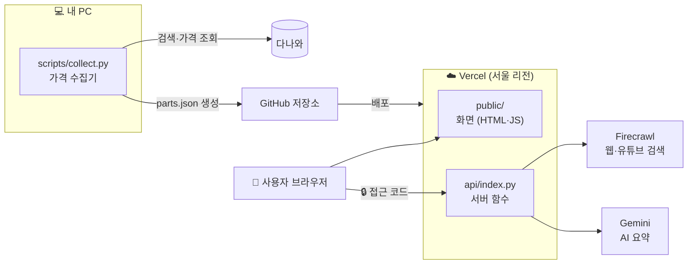

# 🐉 드래곤볼 PC 연구소

> 새 컴퓨터를 맞출 때 **부품 최저가를 모으고**, 예산 안에서 **가성비 꿀조합("드래곤볼")을 자동으로 찾아 주는** 웹사이트입니다.
> AI 코딩 도우미(Claude Code)와 하루 동안 대화하며 만들었고, 그 과정을 학습용으로 정리했습니다.

**🔗 배포 주소: https://dragonball-pc.vercel.app**

| 누구나 쓸 수 있는 기능 | 접근 코드가 필요한 기능 🔒 |
|---|---|
| 부품 가격표 (다나와 91개 부품) | 웹 리서치 + AI 요약 |
| 드래곤볼 빌더 (예산별 추천, 호환성 검사) | 유튜브 리뷰 검색 + 영상 요약 |
| 조합 공유 링크, 견적서 복사 | AI 조합 평가 |

🔒 기능은 유료 API(Gemini, Firecrawl)를 쓰기 때문에 접근 코드로 잠가 두었습니다.

---

## 📚 이 저장소로 배울 수 있는 것

1. **AI 스킬 활용**: 이미 만들어진 도구(k-skill 다나와 검색)를 가져와 내 프로젝트에 붙이기
2. **데이터 수집과 정리**: 검색 → 원본 저장 → CSV/JSON 정리 흐름
3. **웹사이트 만들기**: 프레임워크 없이 HTML·CSS·JavaScript만으로 만든 화면
4. **외부 API 연결**: Firecrawl(웹 검색), Google Gemini(AI 요약)
5. **API 키 지키기**: `.env` 파일, 접근 코드, 요청 횟수 제한
6. **배포하기**: GitHub에 올리고 Vercel로 인터넷 주소 만들기
7. **문제 해결**: 오늘 실제로 막혔던 문제와 그 해결 과정

## 🗺️ 학습 문서 (순서대로 읽으세요)

| 순서 | 문서 | 내용 |
|---|---|---|
| 1 | [오늘의 작업 기록](docs/01-작업기록.md) | 어떤 요청을 했고, 무엇이 만들어졌는지 시간순으로 |
| 2 | [동작 원리](docs/02-동작원리.md) | 데이터가 어디서 와서 화면까지 가는지, 코드 읽는 순서 |
| 3 | [문제 해결 노트](docs/03-문제해결노트.md) | 실제로 겪은 오류 10가지와 해결법 |
| 4 | [직접 따라 하기](docs/04-따라하기.md) | 내 컴퓨터에서 실행하고 내 계정으로 배포하기 |
| 부록 | [기술 레퍼런스](docs/REFERENCE.md) | 환경 변수, API 목록, 비용 보호 설정 |

---

## 🧩 한눈에 보는 구조



- **가격 데이터**는 내 PC에서 미리 모아 `public/data/parts.json`으로 저장해 둡니다. (다나와가 Vercel 서버의 접속을 막기 때문)
- **화면**은 이 JSON을 읽어 표와 추천 조합을 만듭니다. 추천 계산은 브라우저에서 합니다.
- **AI 기능**만 서버 함수(`api/`)를 거칩니다. API 키는 서버에만 있고 브라우저로 보내지 않습니다.

## 📁 폴더 지도

```
pc-build/
├─ public/               👉 화면. 브라우저가 받는 파일
│  ├─ index.html           탭 4개 (빌더 / 가격표 / 웹 리서치 / 유튜브)
│  ├─ app.js               추천 계산, 표 그리기, API 호출
│  ├─ style.css
│  └─ data/parts.json      수집한 부품 가격 (collect.py가 만듦)
├─ api/                  👉 서버. Vercel 함수로 실행
│  ├─ index.py             입구 (모든 /api/* 요청이 여기로)
│  ├─ _core.py             실제 로직: 접근 코드, 요청 제한, Firecrawl·Gemini 호출
│  └─ _kskill_danawa.py    k-skill 다나와 검색 도우미 (MIT 라이선스)
├─ scripts/collect.py    👉 다나와 가격 수집기 (내 PC에서 실행)
├─ web/server.py         👉 내 PC용 개발 서버
├─ data/                 👉 수집 원본(raw)과 엑셀용 CSV(processed)
├─ docs/                 👉 학습 문서
├─ .env.example          👉 API 키 입력 양식 (복사해서 .env로)
├─ start-site.bat        👉 더블클릭하면 내 PC에서 사이트 실행
└─ vercel.json           👉 배포 설정
```

## ⚡ 5분 만에 내 PC에서 실행하기

필요한 것: Windows, Python 3.12 이상 (명령은 `pc-build` 폴더의 명령 프롬프트에서 입력) ([python.org](https://www.python.org/downloads/))

```bat
:: 1. 필요한 라이브러리 설치
py -m pip install -r requirements.txt

:: 2. API 키 양식 복사 (AI 기능을 쓸 때만 키를 채우면 됩니다)
copy .env.example .env

:: 3. 실행 → 브라우저에서 http://127.0.0.1:8000
py -X utf8 web/server.py
```

또는 `start-site.bat`을 더블클릭하세요. 키가 없어도 **가격표와 빌더는 바로 동작**합니다.
자세한 설명과 Vercel 배포 방법은 [직접 따라 하기](docs/04-따라하기.md)에 있습니다.

## ⚠️ 알아 둘 한계

- 가격은 **수집한 시점(2026-10-13)** 다나와 기준입니다. 쿠폰·카드 할인은 반영하지 않습니다.
- 배포판에서는 **다나와 실시간 검색이 꺼져** 있습니다. 다나와가 데이터센터 IP를 막기 때문이며, 우회하지 않았습니다. 실시간 검색은 내 PC 실행에서 됩니다.
- 성능 점수는 대략적인 게이밍 등급 값입니다. 정확한 비교는 웹 리서치·유튜브 탭을 쓰세요.
- 개인 조회용입니다. 대량 수집에 쓰지 마세요.

## 🙏 사용한 것들

- [k-skill](https://github.com/NomaDamas/k-skill) (NomaDamas, MIT): 다나와 검색 도우미. 전문은 `LICENSES/k-skill-MIT.txt`
- [Firecrawl](https://firecrawl.dev): 웹·유튜브 검색
- [Google AI Studio](https://aistudio.google.com) / Gemini: AI 요약
- [marked](https://github.com/markedjs/marked), [DOMPurify](https://github.com/cure53/DOMPurify): AI 답변(마크다운)을 안전하게 표시
- [Vercel](https://vercel.com): 무료 배포
