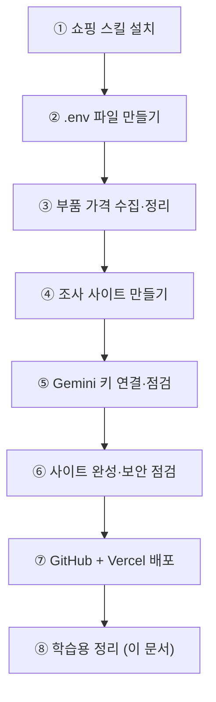

# 1. 오늘의 작업 기록 (2026-10-13)

> 기능을 하나씩 추가하며 하루 만에 만든 과정입니다.
> 각 단계마다 **내가 한 요청 → AI가 한 일 → 결과 → 배운 점** 순서로 정리했습니다.

[← README](../README.md) · 다음: [2. 동작 원리 →](02-동작원리.md)

---

## 전체 흐름 한눈에 보기



| 단계 | 걸린 일 | 결과물 |
|---|---|---|
| ① | 스킬 3개 설치 | 다나와·네이버·쿠팡 검색 스킬 |
| ② | 비밀값 보관 장소 | `.env`, `.gitignore` |
| ③ | 다나와에서 8개 분야 부품 수집 | `data/`, CSV 9개 |
| ④ | 웹사이트 + AI 기능 | `public/`, `web/server.py` |
| ⑤ | Gemini 모델 점검 | 모델 자동 전환 기능 |
| ⑥ | 기능 완성, 보안 점검 | 접근 코드, 요청 제한 |
| ⑦ | 인터넷에 공개 | https://dragonball-pc.vercel.app |

---

## ① 쇼핑 스킬 설치하기

**요청**
```
npx --yes skills add NomaDamas/k-skill --skill danawa-price-search -g
(naver-shopping-search, coupang-product-search도 같은 방법으로)
```

**한 일**: [k-skill](https://github.com/NomaDamas/k-skill)은 한국 서비스용 AI 스킬 모음입니다. 그중 쇼핑 검색 스킬 3개를 내 컴퓨터 전체(`-g`, global)에 설치했습니다.

**결과**: 설치는 됐지만 실제로 쓸 수 있는 건 **다나와 하나**였습니다. 네이버·쿠팡은 스킬이 거쳐 가는 중계 서버가 오류(404, 403)를 냈습니다. (③에서 확인)

> 💡 **배운 점: 스킬이란?**
> AI에게 "이 일은 이렇게 해" 하고 미리 써 둔 설명서 + 도우미 코드 묶음입니다. 처음부터 만들지 않고 남이 만든 걸 가져다 쓸 수 있습니다. 대신 **라이선스**(여기선 MIT)와 **이용 규칙**(개인 조회만, 대량 수집 금지)을 지켜야 합니다.

---

## ② API 키를 저장할 `.env` 만들기

**요청**: "firecrawl api 키를 저장할 .env 파일 생성해줘"

**한 일**
- `.env` 파일을 만들고 `FIRECRAWL_API_KEY=` 칸을 비워 두었습니다. 키는 내가 직접 붙여 넣었습니다.
- `.gitignore`에 `.env`를 넣어 **GitHub에 절대 올라가지 않게** 했습니다.

> 💡 **배운 점: 왜 키를 코드에 쓰지 않을까?**
> API 키는 내 신용카드와 비슷합니다. 코드에 적으면 GitHub에 올라가 누구나 볼 수 있고, 남이 내 돈으로 API를 쓸 수 있습니다. 그래서 키는 `.env`라는 별도 파일에 두고, 그 파일은 Git이 무시하게 합니다. **키를 채팅창에 붙여 넣는 것도 피하세요.**

---

## ③ 부품 최저가 수집하고 폴더 정리하기

**요청**: "새 컴퓨터를 맞추기 위해서 부품 최저가 검색 및 드래곤볼(컴퓨터 조립 가성비 꿀조합) 할건데 먼저 k-skill에 있는 쇼핑몰 스킬을 활용해서 서치해주고 데이터를 폴더 정리해줘"

**한 일**
1. 게이밍 가성비 후보를 8개 분야로 나눠 검색어를 정했습니다. (CPU 6개, 그래픽카드 4개, 메인보드 4개 등)
2. 다나와에서 검색하고, 상위 상품은 **쇼핑몰별 가격**(배송비 포함)까지 받았습니다.
3. 완제품 PC나 노트북처럼 부품이 아닌 결과는 걸러냈습니다.
4. 결과를 세 단계로 저장했습니다.

```
data/raw/danawa/      ← 다나와가 돌려준 원본 그대로 (나중에 다시 계산할 수 있게)
data/processed/*.csv  ← 엑셀로 열어 보는 정리본
public/data/parts.json ← 웹사이트가 읽는 정리본
```

> 💡 **배운 점: 원본과 정리본을 나누는 이유**
> 원본을 남겨 두면 정리 방법을 바꿨을 때 다시 검색하지 않아도 됩니다(`--rebuild-only`). 사이트에 요청을 덜 보내니 상대 서버에도 예의입니다.

---

## ④ 부품 조사 사이트 만들기

**요청**: "firecrawl api 키 .env 에 넣어놨어 그걸 활용해서 컴퓨터 부품조사하는 사이트 만들어주고 (youtube-mcp 참고) ai studio 에서 google api 키 발급가능해."

**한 일**: 탭 4개짜리 사이트를 만들었습니다.

| 탭 | 하는 일 | 쓰는 서비스 |
|---|---|---|
| 드래곤볼 빌더 | 예산·용도를 고르면 최고 성능 조합 추천 | (브라우저 계산) |
| 부품 가격표 | 수집한 가격 표, 정렬·검색 | 다나와 데이터 |
| 웹 리서치 | 벤치마크 글을 찾아 AI가 출처 번호를 붙여 요약 | Firecrawl + Gemini |
| 유튜브 리뷰 | 리뷰 영상을 찾고 AI가 영상을 보고 요약 | Firecrawl + Gemini |

참고로 준 [youtube-mcp](https://github.com/ia-programming/youtube-mcp) 저장소는 **설치하지 않고 방법만 참고**했습니다. Gemini가 유튜브 주소를 직접 받아 영상을 요약할 수 있다는 점입니다.

---

## ⑤ Google API 키 연결하고 점검하기

**요청**: "구글 API 키 같은 곳에 넣어야하니?" → "키 넣었어 확인해줘" → "저장완료했어"

**한 일**
- 같은 `.env`의 `GOOGLE_API_KEY=` 줄에 넣으면 된다고 안내했습니다.
- 처음 확인했을 때 키가 비어 있었습니다. **편집기에서 저장(Ctrl+S)을 안 한 상태**였습니다.
- 저장 후 키는 정상이었지만, **모델마다 상태가 달랐습니다**.

| 모델 | 결과 |
|---|---|
| `gemini-2.5-*` | 404: 새 사용자는 쓸 수 없음 |
| Pro 계열 | 429: 무료 할당량 없음 |
| Flash 계열 | 503 또는 응답 없음 (혼잡) |
| **Flash-Lite 계열** | ✅ 1~3초 안에 응답 |

그래서 **모델 자동 전환(fallback)** 을 넣었습니다. 첫 모델이 실패하면 다음 모델로 넘어가고, 실패한 모델은 10분 동안 뒤로 미룹니다.

> 💡 **배운 점**: "키가 맞다"와 "기능이 된다"는 다릅니다. 키 확인 후 실제 호출까지 해 봐야 합니다. 자세한 내용은 [문제 해결 노트](03-문제해결노트.md)에 있습니다.

---

## ⑥ 사이트 완성하고 보안 점검하기

**요청**: "새 컴퓨터를 맞추기 위해서 부품 최저가 검색 및 드래곤볼 사이트 완성시켜주고. 깃허브에 올려서 URL로 배포해줘"

AI가 먼저 두 가지를 물었고, 이렇게 골랐습니다.
- AI 기능 보호 방법 → **접근 코드로 보호**
- GitHub 저장소 → **비공개**

**추가하거나 고친 것**
- ✨ 기능: 부품별 최저가 쇼핑몰 바로가기, 조합 공유 링크(`#b=`), 견적서 복사, 정렬·검색, 모바일 화면, 처음 온 사람용 3단계 안내
- 🐞 버그: 빌더가 안내와 달리 **현금 결제가**를 섞어 계산하던 문제. 이제 가격마다 `일반결제 / 표시가 / 현금` 표시를 붙입니다.
- 🔐 보안
  - 접근 코드 없이는 AI 기능 사용 불가 (401)
  - 요청 횟수 제한 (한 사람당, 전체 합산)
  - 내부 주소를 몰래 요청하게 만드는 공격(SSRF) 차단
  - **심각한 문제 수정**: 처음 만든 로컬 서버는 검색어를 명령줄에 그대로 넣어 실행했기 때문에, 검색어에 명령어를 섞으면 내 PC에서 실행될 수 있었습니다. 도우미 코드를 직접 불러오는 방식으로 바꿔 해결했습니다.
- ✅ 점검: 여러 AI 에이전트가 기능과 보안을 따로 검토하고, 고친 뒤 다시 검토했습니다.

> 💡 **배운 점: 공개 전에 "남이 쓰면 어떻게 될까?" 생각하기**
> 내 PC에서만 쓸 때는 괜찮던 코드도 인터넷에 올리면 위험해집니다. 누군가 내 API 키로 요청을 수천 번 보내거나, 이상한 입력을 넣을 수 있습니다.

---

## ⑦ GitHub에 올리고 Vercel로 배포하기

**한 일**
1. `pc-build` 폴더를 Git 저장소로 만들고 **비공개** 저장소 `dragonball-pc`로 올렸습니다.
2. 올리기 전에 비밀값이 섞였는지 검사했습니다 → 깨끗함.
3. Vercel 프로젝트를 만들고 **서울 리전(icn1)** 으로 배포했습니다.
4. API 키 4개와 접근 코드는 **Vercel 환경 변수**에만 넣었습니다.
5. 배포한 주소에서 기능을 하나씩 실제로 눌러 확인했습니다.

**예상 못 한 문제**: 다나와가 Vercel 서버의 접속을 **403(접근 금지)** 으로 막았습니다. 서울 리전도 같았습니다.
→ 차단을 우회하는 건 이용 규칙 위반이라 하지 않았습니다. 대신 **가격은 내 PC에서 모아 올리고**, 배포판은 그 가격표를 보여 주게 했습니다(`DANAWA_LIVE=0`).

**최종 확인 결과**

| 기능 | 결과 |
|---|---|
| 부품 가격표, 드래곤볼 빌더 | ✅ |
| 접근 코드 없이 AI 기능 → 401 | ✅ |
| 웹 리서치 + AI 요약 | ✅ (약 16초) |
| 유튜브 검색, 조합 평가 | ✅ |
| 다나와 실시간 검색 | ⛔ 배포판에서는 끔 (내 PC에서는 됨) |

---

## ⑧ 오늘 수집한 가격으로 본 결과

- 2026년 10월 현재 부품값이 높습니다. 특히 RAM(DDR5 16GB×2)이 약 65만 원입니다.
- 그래서 **가장 싼 완성 조합이 약 260만 원**입니다. 빌더의 150~250만 원 버튼은 "예산 부족" 안내가 뜹니다.
- 가격을 새로 받으려면 내 PC에서 `scripts/collect.py`를 실행하고 GitHub에 올리면 됩니다. → [따라 하기](04-따라하기.md#가격-새로-받기)

---

## 🎯 오늘의 핵심 정리

1. **남이 만든 도구를 잘 가져다 쓰자.** 대신 라이선스와 이용 규칙을 지킨다.
2. **비밀값은 `.env`에.** GitHub, 채팅, 코드에 절대 쓰지 않는다.
3. **"된다"고 믿지 말고 직접 실행해서 확인하자.** 키 확인, 모델 확인, 배포 후 확인.
4. **공개 전에는 보안 점검.** 접근 코드, 요청 제한, 입력 검사.
5. **막히면 우회하지 말고 설계를 바꾸자.** 다나와 차단 → 미리 수집한 데이터 사용.

[← README](../README.md) · 다음: [2. 동작 원리 →](02-동작원리.md)
