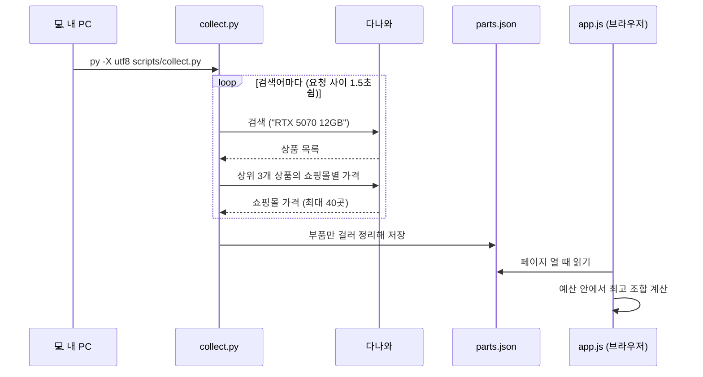
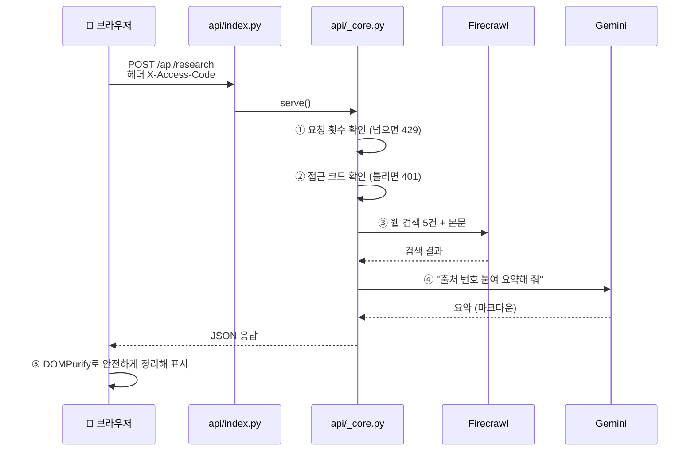

# 2. 동작 원리: 데이터는 어디서 와서 화면까지 갈까?

> 코드를 처음 읽는 사람을 위한 안내입니다. 전체 흐름을 먼저 보고, 그다음 파일 하나씩 따라갑니다.

[← 1. 작업 기록](01-작업기록.md) · 다음: [3. 문제 해결 노트 →](03-문제해결노트.md)

---

## 큰 그림: 두 가지 길

이 사이트에는 데이터가 오가는 길이 두 가지 있습니다.

| | 🅰️ 가격 데이터의 길 | 🅱️ AI 기능의 길 |
|---|---|---|
| 언제 | 미리 (내 PC에서 가끔) | 사용자가 버튼을 누를 때마다 |
| 누가 계산 | `collect.py` → 브라우저(`app.js`) | 서버(`api/_core.py`) |
| 비용 | 무료 | 유료 API (그래서 🔒 잠금) |
| 파일 | `parts.json` | 없음 (그때그때 응답) |

---

## 🅰️ 가격 데이터의 길



### 1단계: 수집 (`scripts/collect.py`)

- 맨 위의 `QUERIES`에 **분야별 검색어**가 있습니다. 여기만 바꾸면 다른 부품도 모을 수 있습니다.
  ```python
  QUERIES = {
      "01_CPU": ["라이젠5 9600X 정품", "라이젠7 9700X 정품", ...],
      "02_GPU": ["RTX 5060 Ti 16GB", "RTX 5070 12GB", "RX 9070 XT", "RTX 5070 Ti"],
      ...
  }
  ```
- `is_part()`가 "조립PC", "노트북" 같은 완제품을 걸러냅니다.
- `build_row()`가 쇼핑몰 가격 중에서 **일반결제 최저가**와 **현금·조건부 최저가**를 따로 골라 한 줄로 만듭니다.
- **안전장치**: 결과가 이전의 절반도 안 되면 기존 파일을 덮어쓰지 않고 멈춥니다. 다나와가 잠깐 빈 결과를 줘도 좋은 데이터가 지워지지 않습니다.

### 2단계: 추천 계산 (`public/app.js`의 `recommend()`)

서버 없이 **브라우저에서** 계산합니다. 핵심 아이디어는 이렇습니다.

1. **성능 점수표**: 그래픽카드와 CPU에 대략적인 게이밍 점수를 매깁니다.
   ```js
   const GPU_TIERS = [[/5070\s*Ti/i, 165], [/9070\s*XT/i, 155], ..., [/5060\s*Ti/i, 100]];
   const CPU_TIERS = [[/9800X3D/i, 100], [/7800X3D/i, 90], ..., [/14400F/i, 60]];
   ```
2. **용도별 가중치**: QHD 게이밍이면 그래픽카드 65%, CPU 35%를 반영합니다.
   ```js
   qhd: { label: "게이밍 (QHD)", gpu: 0.65, cpu: 0.35 },
   ```
3. **모든 CPU × 그래픽카드 조합을 만들어 봅니다.** 조합마다
   - CPU **소켓이 맞는** 가장 싼 메인보드
   - 그래픽카드가 요구하는 **파워 용량 이상**의 가장 싼 파워
   - X3D CPU면 **큰 쿨러**
   - RAM 32GB, SSD, 케이스는 가장 싼 것
4. **예산 안에 드는 조합 중 점수가 가장 높은 3개**를 보여 줍니다. 가성비(점수 ÷ 가격) 1등도 따로 알려 줍니다.

> 🤔 **생각해 볼 문제**: 성능 점수표를 내가 좋아하는 벤치마크 수치로 바꾸면 추천이 어떻게 달라질까요?

---

## 🅱️ AI 기능의 길



### 파일별 역할

| 파일 | 역할 | 먼저 볼 함수 |
|---|---|---|
| `api/index.py` | Vercel이 부르는 입구. GET/POST를 `_core`로 넘김 | `handler` |
| `api/_core.py` | 모든 로직 | `route()` |
| `web/server.py` | 내 PC에서 같은 `_core`를 돌리는 개발 서버 | `Handler` |

`web/server.py`와 `api/index.py`가 **같은 `_core.py`를 공유**합니다. 그래서 내 PC에서 확인한 동작이 배포판에서도 똑같습니다.

### `route()` 읽는 순서

`api/_core.py`의 `route()`를 위에서 아래로 읽으면 요청 하나가 처리되는 순서가 그대로 보입니다.

1. 없는 주소면 404, 방식이 틀리면 405
2. `/api/status`는 누구나 볼 수 있음 (잠금 여부만 알려 줌, 키 값은 절대 안 보냄)
3. **요청 횟수 제한 먼저**, 그다음 **접근 코드 확인**. 접근 코드를 무작정 대입해 맞히는 시도를 막으려는 순서입니다.
4. 경로별 처리: `/api/research`, `/api/youtube/search`, `/api/build/advise` 등

### Gemini 호출: 모델 자동 전환 (`gemini()`)

```
gemini-flash-latest → 실패(503) → gemini-flash-lite-latest → 성공 ✅
                      └ 이 모델은 60초 동안 뒤로 미룸 (404·429는 10분)
```

모델마다 상태가 다를 수 있어서([작업 기록 ⑤](01-작업기록.md)) 하나가 막혀도 사이트가 멈추지 않게 했습니다.

### AI에게 주는 지시문

```python
SYSTEM_KO = "너는 한국 PC 조립 커뮤니티의 하드웨어 전문가다. 한국어로, 핵심만 마크다운 불릿으로 답한다. ..."
PRICE_NOTE = "주어진 가격은 오늘 다나와에서 조회한 실제 시세다. 네가 학습한 과거 시세와 달라도 ..."
```

`PRICE_NOTE`가 왜 필요할까요? AI는 예전 가격을 학습했기 때문에, 올해 오른 RAM 가격을 보고 "가격이 비정상"이라고 답한 적이 있습니다. 오늘 날짜와 "실제 시세"라는 설명을 함께 주어 해결했습니다.

---

## 🔐 보안 장치 모아 보기

| 위협 | 막는 방법 | 위치 |
|---|---|---|
| API 키 유출 | 키는 서버 환경 변수에만, 응답·로그에 안 보냄 | `_core.py` `load_env()` |
| 남이 내 키로 AI 사용 | 접근 코드 (`X-Access-Code` 헤더) | `check_access()` |
| 요청 폭주로 요금 폭탄 | IP별 + 전체 합산 횟수 제한 | `RateLimiter` |
| 서버가 내부 주소를 요청하게 만들기 (SSRF) | 공개 인터넷 주소만 허용 | `check_public_host()` |
| AI 답변에 숨긴 악성 HTML | DOMPurify로 위험한 태그 제거 | `app.js` `PURIFY` |
| 검색어로 명령어 실행 | 명령줄을 쓰지 않고 함수를 직접 호출 | `danawa_call()` |
| 다른 사이트가 내 PC 서버 호출 | 127.0.0.1만 열고, 다른 출처 요청 거절 | `web/server.py` `_foreign()` |

> ⚠️ 코드 안의 횟수 제한은 서버 인스턴스마다 따로 셉니다. **진짜 비용 상한은 Google·Firecrawl 대시보드에서 설정**하세요. → [기술 레퍼런스](REFERENCE.md#비용-보호-꼭-설정하세요)

---

## 📖 코드 읽기 추천 순서

1. `public/index.html`: 화면이 어떻게 나뉘었는지 (탭 4개)
2. `public/app.js` 앞부분: `CATS`, `GPU_TIERS`, `PURPOSES` 같은 설정값
3. `public/app.js` `recommend()`: 추천 알고리즘
4. `scripts/collect.py` `QUERIES`와 `main()`: 데이터가 만들어지는 과정
5. `api/_core.py` `route()`: 서버가 요청을 처리하는 순서
6. `api/_core.py` `gemini()`: 외부 AI 호출과 실패 처리

[← 1. 작업 기록](01-작업기록.md) · 다음: [3. 문제 해결 노트 →](03-문제해결노트.md)
