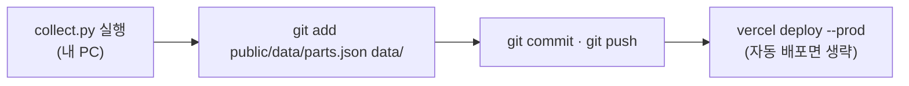

# 4. 직접 따라 하기

> 내 컴퓨터에서 실행하고, 내 계정으로 인터넷에 배포하는 방법입니다.
> 명령은 모두 `pc-build` 폴더에서 **명령 프롬프트(cmd)** 로 입력합니다.

[← 3. 문제 해결 노트](03-문제해결노트.md) · [README](../README.md)

---

## 0. 준비물

| 필요한 것 | 어디서 | 꼭 필요? |
|---|---|---|
| Python 3.12 이상 | [python.org](https://www.python.org/downloads/) (설치할 때 "Add to PATH" 체크) | 필수 |
| Git | [git-scm.com](https://git-scm.com) | 배포할 때 |
| Node.js | [nodejs.org](https://nodejs.org) | 배포할 때 (Vercel 명령) |
| Firecrawl API 키 | [firecrawl.dev](https://firecrawl.dev) → API Keys | AI 기능을 쓸 때 |
| Google API 키 | [aistudio.google.com](https://aistudio.google.com) → Get API key | AI 기능을 쓸 때 |
| GitHub, Vercel 계정 | github.com, vercel.com | 배포할 때 |

---

## 1. 내 PC에서 실행하기

### 1-1. 라이브러리 설치
```bat
py -m pip install -r requirements.txt
```

### 1-2. `.env` 만들기
```bat
copy .env.example .env
notepad .env
```
키를 채우고 **꼭 저장(Ctrl+S)** 하세요. `SITE_ACCESS_CODE`에는 남이 맞히기 어려운 긴 값을 직접 정해 넣습니다.

> 키를 비워 두어도 가격표와 빌더는 동작합니다. 접근 코드가 필요한 기능만 꺼집니다.

### 1-3. 실행
```bat
start-site.bat
```
브라우저에서 http://127.0.0.1:8000 이 열립니다. 콘솔에 이런 줄이 보이면 성공입니다.
```
드래곤볼 PC 연구소: http://127.0.0.1:8000
  접근 코드: 설정됨 / Firecrawl: ON / Gemini: ON / 다나와: ON
```

### 1-4. 써 보기
1. **드래곤볼 빌더** 탭 → 예산 버튼 누르기 → 추천 조합 확인
2. **부품 가격표** 탭 → 분야 바꾸기, 정렬, 검색
3. **웹 리서치** 탭 → 검색 → 접근 코드 입력창에 `.env`의 `SITE_ACCESS_CODE` 입력

---

## 가격 새로 받기

가격은 자동으로 바뀌지 않습니다. 새 시세가 필요하면 직접 수집합니다.

```bat
:: 빈 항목만 새로 받기 (빠름)
py -X utf8 scripts/collect.py

:: 전부 새로 받기 (몇 분 걸림)
py -X utf8 scripts/collect.py --fresh

:: 인터넷 없이 원본으로 결과 파일만 다시 만들기
py -X utf8 scripts/collect.py --rebuild-only
```

다른 부품을 찾고 싶다면 `scripts/collect.py`의 `QUERIES`에 검색어를 추가하세요.

> **개인 조회 용도로만** 쓰세요. 수집기는 요청 사이에 1.5초씩 쉽니다. 이 값을 줄이거나 검색어를 대량으로 늘리지 마세요.

---

## 2. GitHub에 올리기

```bat
git init
git add .
git status
```
**`git status` 목록에 `.env`가 없는지 꼭 확인하세요.** `.gitignore`가 막아 줍니다.

```bat
git commit -m "첫 커밋"
gh repo create dragonball-pc --private --source . --push
```
(`gh`는 [GitHub CLI](https://cli.github.com)입니다. 웹에서 저장소를 만들고 `git remote add` 후 `git push`해도 됩니다.)

---

## 3. Vercel로 배포하기

### 3-1. 배포
```bat
npm i -g vercel
vercel login
vercel deploy --prod
```
처음 물어보는 질문은 기본값으로 답하면 됩니다. 설정은 `vercel.json`에 이미 들어 있습니다.
- 출력 폴더 `public`, 빌드 명령 없음
- `/api/*` → `api/index.py` (Python 함수)
- 리전 `icn1` (서울)

### 3-2. 환경 변수 넣기
Vercel 대시보드 → 프로젝트 → **Settings → Environment Variables**

| 이름 | 값 |
|---|---|
| `FIRECRAWL_API_KEY` | Firecrawl 키 |
| `GOOGLE_API_KEY` | Google AI Studio 키 |
| `GEMINI_MODEL` | `gemini-flash-latest` |
| `SITE_ACCESS_CODE` | 내가 정한 접근 코드 |
| `DANAWA_LIVE` | `0` (다나와가 Vercel을 막기 때문) |

넣은 뒤 **다시 배포**해야 적용됩니다: `vercel deploy --prod`

### 3-3. 확인
브라우저에서 `https://<내-프로젝트>.vercel.app/api/status`를 열어 보세요.
```json
{"ok": true, "locked": true, "firecrawl": true, "gemini": true, "danawa_live": false, ...}
```
`locked`, `firecrawl`, `gemini`가 모두 `true`면 준비 완료입니다.

### 3-4. 자동 배포 (선택)
GitHub에 올릴 때마다 자동으로 배포되게 하려면 [문제 해결 노트 10번](03-문제해결노트.md)을 따라 Vercel GitHub 앱에 저장소 권한을 준 뒤 `vercel git connect`를 실행하세요.

---

## 4. 가격 갱신 → 배포 반복하기



```bat
py -X utf8 scripts/collect.py
git add public/data/parts.json data/
git commit -m "가격 갱신"
git push
vercel deploy --prod
```

---

## 5. 꼭 해야 할 비용 보호

접근 코드와 요청 제한이 있어도, **최종 안전장치는 각 서비스의 대시보드**입니다.

- **Google**: Cloud Console에서 API 키의 하루 요청 할당량을 낮추고, 결제 계정에 예산 알림을 겁니다.
- **Firecrawl**: 자동 충전을 끄거나 상한을 둡니다.
- **접근 코드가 새어 나갔다면**: Vercel 환경 변수에서 `SITE_ACCESS_CODE`를 바꾸고 다시 배포합니다. 이전 코드는 즉시 막힙니다.

---

## 더 해 볼 만한 과제

| 난이도 | 과제 | 건드릴 곳 |
|---|---|---|
| 기초 | 검색어에 다른 그래픽카드 추가하기 | `collect.py` `QUERIES`, `app.js` `GPU_TIERS` |
| 기초 | 예산 버튼 금액 바꾸기 | `app.js` `BUDGET_PRESETS` |
| 중급 | "사무용" 용도 추가하기 | `app.js` `PURPOSES` |
| 중급 | 모니터 분야 추가하기 | `QUERIES`, `CATS`, `recommend()` |
| 심화 | 수집할 때마다 가격을 기록해 부품별 가격 변화 그래프 그리기 | `collect.py`, `app.js` |

[← 3. 문제 해결 노트](03-문제해결노트.md) · [README](../README.md)
